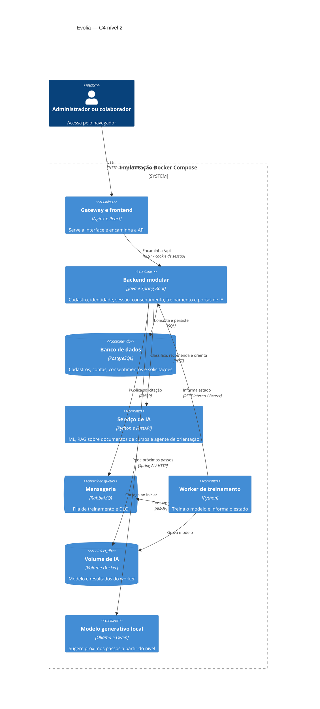

# Evolia — Inteligência que desenvolve pessoas

Plataforma acadêmica de educação corporativa que conecta colaboradores, cursos, competências e
inteligência artificial. Projeto da AF de DevOps e QA (Estudo de Caso 1), do curso de Engenharia de
Computação. **Não é um produto de produção nem uma solução certificada**: roda localmente, com dados e
documentos fictícios.

## O problema

Uma organização com equipe reduzida precisa cadastrar pessoas e cursos, estimar o nível de competência
de cada colaborador, recomendar o que estudar a partir de documentos institucionais e orientar o
desenvolvimento com respeito à privacidade, sem que a evolução da IA comprometa o cadastro e a consulta.

## Funcionalidades

| Quem | O que faz |
| --- | --- |
| Visitante | Conhece a plataforma na página pública (`/`). |
| Administrador | Cadastra e consulta colaboradores e cursos, cria contas individuais, solicita e acompanha treinamentos do modelo. |
| Colaborador (conta individual) | Autoriza ou revoga o uso da IA, avalia três competências, recebe a estimativa do nível, recomendações com fontes e orientação, e consulta o catálogo. |
| Colaborador de demonstração | Consulta o catálogo. Não tem IA, consentimento nem dados pessoais. |

A autorização do uso da IA nunca vem marcada e é verificada no servidor antes de cada operação. Notas,
perguntas e respostas existem apenas durante a sessão aberta. Não há matrículas, progresso, certificados,
gamificação, recuperação de senha nem histórico de conversa.

## Tecnologias

React 19, TypeScript, Vite, Tailwind CSS e TanStack Query · Nginx · Java 17 (compilação e contêineres), Spring Boot,
Spring Security, Spring AI, Flyway · PostgreSQL 17 · RabbitMQ 4 · Python 3.13, FastAPI, scikit-learn ·
Ollama (opcional na prática: sem ele a orientação base continua) · Docker Compose · GitHub Actions.

## Arquitetura (C4 — contêineres)

Monólito modular híbrido: o negócio fica no Spring Boot, a IA em processos separados e o treinamento
passa por fila. REST nas chamadas que precisam de resposta imediata; RabbitMQ no treinamento, que é
demorado e deve continuar aceitando pedidos com o ML indisponível.



Somente o gateway publica porta no Compose padrão, e apenas em `127.0.0.1`. Dois trabalhos de
inicialização (topologia do RabbitMQ e download do modelo) não aparecem no diagrama.

Detalhes, ASRs e decisões: [arquitetura](docs/arquitetura-af.md) (inclui o
[ADR do monólito modular híbrido](docs/arquitetura-af.md#e-adr--monólito-modular-híbrido) e o
[ADR 002, sessões no servidor](docs/arquitetura-af.md#adr-002--sessões-no-servidor-no-lugar-de-http-basic)).

## Estrutura do repositório

| Pasta ou arquivo | Conteúdo |
| --- | --- |
| `backend/` | API REST Java/Spring Boot, PostgreSQL, Flyway, segurança |
| `frontend/` | Interface React e configuração do gateway Nginx |
| `ai-service/` | Classificação, recomendações sobre documentos, orientação e worker de treinamento |
| `infra/` | Topologia RabbitMQ e documentação do ambiente |
| `integration-tests/` | Testes ponta a ponta e roteiros de carga |
| `scripts/` | Geração do `.env`, preenchimento do catálogo e testes integrados |
| `docs/` | Arquitetura, evidências dos requisitos e roteiro da apresentação |
| `docker-compose.yml`, `compose.*.yml` | Ambiente integrado, diagnóstico e Ollama nativo |
| `.github/workflows/` | Pipeline de CI |

Detalhes: [backend](backend/README.md) · [ai-service](ai-service/README.md) · [infra](infra/README.md) ·
[contratos da API](frontend/API_CONTRACTS.md) · [design system](frontend/DESIGN_SYSTEM.md) ·
[créditos das imagens](frontend/src/assets/CREDITOS.md).

## Configuração e execução

Requisitos: Docker com o plugin Compose, Bash (no Windows, Git Bash) e internet no primeiro build.
A aplicação não exige Node, Java, Python ou Ollama instalados.

```bash
bash scripts/gerar-env.sh      # só na primeira vez; preserva um .env existente
docker compose up -d --build   # sobe tudo
```

Acesse <http://127.0.0.1:8088> (saúde: `/healthz`). Se a porta estiver ocupada, defina `GATEWAY_PORT`
no `.env`. Fora desta máquina, use HTTPS e `SESSION_COOKIE_SECURE=true`.

O Ollama baixa o modelo na primeira execução; até terminar, a orientação funciona sem os próximos passos
gerados. Para parar preservando os dados: `docker compose stop` (ou `docker compose down`, que mantém os
volumes). **Não use `docker compose down -v`**, que apaga o banco.

### Preencher o catálogo

Uma instalação nova começa sem cursos. Com a pilha no ar:

```bash
python3 scripts/preencher_catalogo.py            # 18 cursos de demonstração
python3 scripts/preencher_catalogo.py --simular  # apenas mostra o que falta
```

O script usa a API (sessão, CSRF e contexto), não acessa o banco, não duplica nomes e não apaga nada.

### Acesso e perfis

Nenhuma credencial é publicada. O `gerar-env.sh` cria, no `.env` local, uma conta de administrador e uma
de demonstração (nomes em `AFDEVOPS_*_USERNAME`, senhas em `E2E_*_PASSWORD`). Consulte o arquivo apenas
na sua máquina e não o versione.

Para a conta individual, que usa a IA: entre como administrador, cadastre um colaborador e crie a conta
dele em **Contas**, com senha de pelo menos 12 caracteres. Depois entre com essa conta e autorize a IA em
**Privacidade e IA**.

O acesso usa sessão no servidor com cookie `HttpOnly`; expira após 30 minutos sem uso, e reiniciar o
backend encerra as sessões.

## Testes

Resultados na versão atual, em 28/11/2026, nesta máquina:

| Verificação | Resultado |
| --- | --- |
| Java (unitários e Testcontainers), `./mvnw -B verify` | 274 de 274 |
| Python (`ai-service`, contêiner `python:3.13-slim`) | 40 de 40 |
| Frontend: typecheck, ESLint, build e Vitest | 574 de 574 |
| Integração pelo gateway, em projeto Compose isolado | 55 de 55 |
| Fluxos reais no navegador (três perfis, pilha isolada) | 39 passos |
| `nginx -t` e CSP sem violações nos fluxos | OK |

A suíte do frontend já mostrou falhas intermitentes com a máquina carregada
([pendências](frontend/PENDENCIAS.md)). A CI **não rodou** sobre esta versão.

```bash
# frontend (Node 24)
cd frontend && npm ci && npm run typecheck && npm run lint && npm test && npm run build
# backend (JDK 21 e Docker em execução)
cd backend && ./mvnw -B verify
# serviço de IA (Python 3.13)
cd ai-service && pip install -r requirements.txt && python -m pytest
# ponta a ponta: grava cursos e treinamentos de teste na pilha usada
./scripts/testes-integrados.sh
```

## Desempenho (RNF01)

Meta: 95% das consultas de classificação em até 2 s com 300 usuários simultâneos.

| Momento | Revisão medida | 300 usuários |
| --- | --- | --- |
| Antes (HTTP Basic) | `23ea620` com alterações locais (referência: tag `checkpoint-etapa14`) | Inconclusivo: 2 POSTs e falhas de CSRF; a 200 usuários, p95 de 16,5 s |
| Depois (sessões) | `676ad62` (árvore limpa) | 17.826 de 17.826 no prazo, p95 do POST de 33 ms, sem falhas |

Medições **locais**, uma instância por serviço, uma rodada por patamar, janela de 120 s, Ollama
desligado. Não foram repetidas depois do redesenho da interface; backend, serviço de IA e Compose não
mudaram desde `676ad62`, exceto o acervo documental do RAG, que não participa da classificação. Dados e
limites: [evidências](docs/evidencias-af.md#rnf01--carga-de-classificação).

## Situação dos requisitos

| Requisito | Situação |
| --- | --- |
| RF01 cadastro e consulta · RF02 classificação por ML · RF05 acompanhamento de treinamento | Atendidos, com os recortes descritos nas evidências |
| RF03 recomendação por RAG | Atendido com ressalva (geração determinística, sem LLM redigindo) |
| RF04 orientação e acompanhamento por agente | **Parcial** (há orientação e autorização; não há acompanhamento) |
| RNF01 desempenho | Atendido nas condições testadas |
| RNF02 disponibilidade · RNF04 evolução independente | Atendidos nos cenários executados |
| RNF03 proteção de dados | Atendido no recorte local |
| RNF05 custo | Evidência favorável, só para a demonstração local |

Detalhes: [matriz de evidências](docs/evidencias-af.md#situação-resumida).

## Limitações

- Ambiente local, sem HTTPS próprio, alta disponibilidade ou observabilidade de produção.
- Sessões em memória: uma instância do backend.
- Modelo treinado com base sintética; o resultado é uma estimativa, não avaliação de desempenho.
- Doze documentos fictícios no RAG, sem ligação com o catálogo; as fontes valem para o conjunto das recomendações. Alguns títulos existem nos dois com níveis diferentes (por exemplo, “Segurança da informação no cotidiano” é básico no catálogo e intermediário no acervo).
- Um modelo recém-treinado só é usado depois de reiniciar o serviço de IA.
- Listagens sem paginação; não há edição ou exclusão de cadastros.
- As imagens da interface foram geradas por IA; não retratam pessoas reais.

## Equipe

Identificação conforme o histórico do Git (nomes completos e RAs: a completar pela equipe).

| Integrante (Git) | Contribuições registradas nos commits |
| --- | --- |
| `mjdutil` | Backend (identidade, sessão, consentimento, integração de IA), frontend, infraestrutura, testes integrados, documentação |
| Felipe Brito | Backend (solicitações de treinamento), infraestrutura RabbitMQ/Compose, testes integrados, scripts, CI e documentação de infraestrutura |
| `rrezeendisa` | Serviço de IA: classificação, recomendações, orientação e worker |
