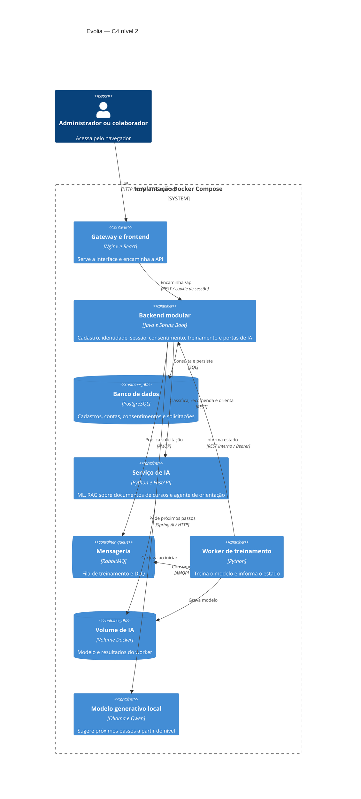

# Af_DevOps
Projeto AF da matéria de DevOps — Plataforma Inteligente de Educação Corporativa

## Arquitetura (C4 — contêineres)

Monólito modular híbrido: negócio em Spring Boot, IA em processos separados e treinamento por fila.



Somente o gateway publica porta no Compose padrão.

## Documentação da AF

| Tema | Onde |
|---|---|
| Organização no código e comunicação | [Arquitetura](docs/arquitetura-af.md#a-organização-arquitetural-no-código) · [REST e RabbitMQ](docs/arquitetura-af.md#c-comunicação-arquitetural) |
| Requisitos arquiteturalmente significativos | [ASRs](docs/arquitetura-af.md#d-requisitos-arquiteturalmente-significativos) |
| Decisões arquiteturais | [ADR: monólito modular híbrido](docs/arquitetura-af.md#e-adr--monólito-modular-híbrido) · [ADR 002: sessões no lugar de HTTP Basic](docs/arquitetura-af.md#adr-002--sessões-no-servidor-no-lugar-de-http-basic) |
| Situação de RF01–RF05 e RNF01–RNF05 | [Matriz de evidências](docs/evidencias-af.md#situação-resumida) |
| Dados das medições | [Etapa 14.1, estado atual](docs/evidencias-etapa14-1/README.md) · [Etapa 14, histórico](docs/evidencias-etapa14/README.md) |

O RNF01 foi atendido nas condições testadas (300 usuários, p95 de 33 ms, ambiente local); veja os [resultados e limites](docs/evidencias-af.md#rnf01--carga-de-classificação).

## Estrutura

| Pasta | Conteúdo | Frente |
| --- | --- | --- |
| `backend/` | API REST Java/Spring Boot, PostgreSQL, Flyway, segurança | A |
| `frontend/` | Interface React da Evolia e configuração do gateway Nginx | A |
| `ai-service/` | Classificação (ML), recomendações, orientação e worker de treinamento | B |
| `infra/` | Topologia RabbitMQ e documentação do ambiente integrado | C |
| `integration-tests/` | Testes ponta a ponta contra o ambiente Docker Compose | C |
| `scripts/` | Geração do `.env` local e execução dos testes integrados | C |
| `.github/workflows/` | Pipeline de CI | C |

Detalhes de cada parte: [backend/README.md](backend/README.md),
[ai-service/README.md](ai-service/README.md) e [infra/README.md](infra/README.md).

## Ambiente integrado com Docker Compose

Use Docker com o plugin Compose, Bash e acesso à internet no primeiro build.
No Windows, use Git Bash. A execução da aplicação dispensa instalações locais
de Node.js, Java, Python e Ollama.

No primeiro uso, gere o `.env`. Esta etapa é um pré-requisito de segurança para
`docker compose up --build`. O script cria credenciais fictícias e aleatórias
com permissões restritas. Se já existir um `.env`, o script o preserva.

```bash
bash scripts/gerar-env.sh
```

Com o `.env` preparado, um comando inicia o ambiente completo.

```bash
docker compose up --build
```

Acesse a Evolia em <http://127.0.0.1:8088>. Consulte o `.env` localmente
para obter os nomes `AFDEVOPS_*_USERNAME` e as senhas `E2E_*_PASSWORD` das
contas de demonstração. Use o ADMIN para cadastrar um colaborador e criar a
conta individual que poderá autorizar o uso da IA.

O Nginx serve a interface e encaminha `/api` ao Java na mesma origem. Se a
porta estiver ocupada, defina `GATEWAY_PORT` no `.env`. Fora da máquina
local, use HTTPS e defina `SESSION_COOKIE_SECURE=true`.

O acesso usa sessão no servidor: a senha é enviada uma vez, no login, e o
navegador guarda um cookie `HttpOnly`. A sessão expira após 30 minutos de
inatividade.

O Ollama baixa o modelo no primeiro uso e reaproveita o volume nas próximas
execuções. Enquanto o download estiver em andamento, a orientação base
continua disponível. A rota de saúde do gateway é `/healthz`.

Use `docker compose stop` para parar e preservar o ambiente ou
`docker compose down` para remover os containers e preservar os volumes.
Consulte a [documentação de infraestrutura](infra/README.md) para diagnóstico,
alternativa com Ollama nativo e a suíte de integração, que usa Python 3.12+.

## Integração contínua

A pipeline [`.github/workflows/ci.yml`](.github/workflows/ci.yml) roda em
pull requests e na `main`. Ela verifica Java, Python e frontend, valida os
arquivos Compose e constrói as imagens. Os testes integrados usam o gateway,
o Java e o worker. A geração pelo Ollama tem validação separada.

A CI está configurada e ainda não foi executada no GitHub. Os roteiros de
carga e falhas, executados localmente, ficam em
[`integration-tests/carga/`](integration-tests/carga/README.md).
