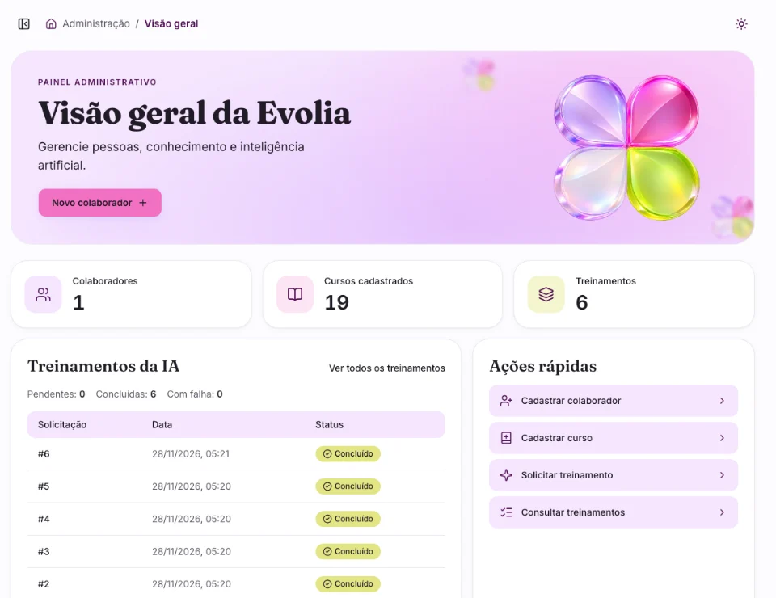
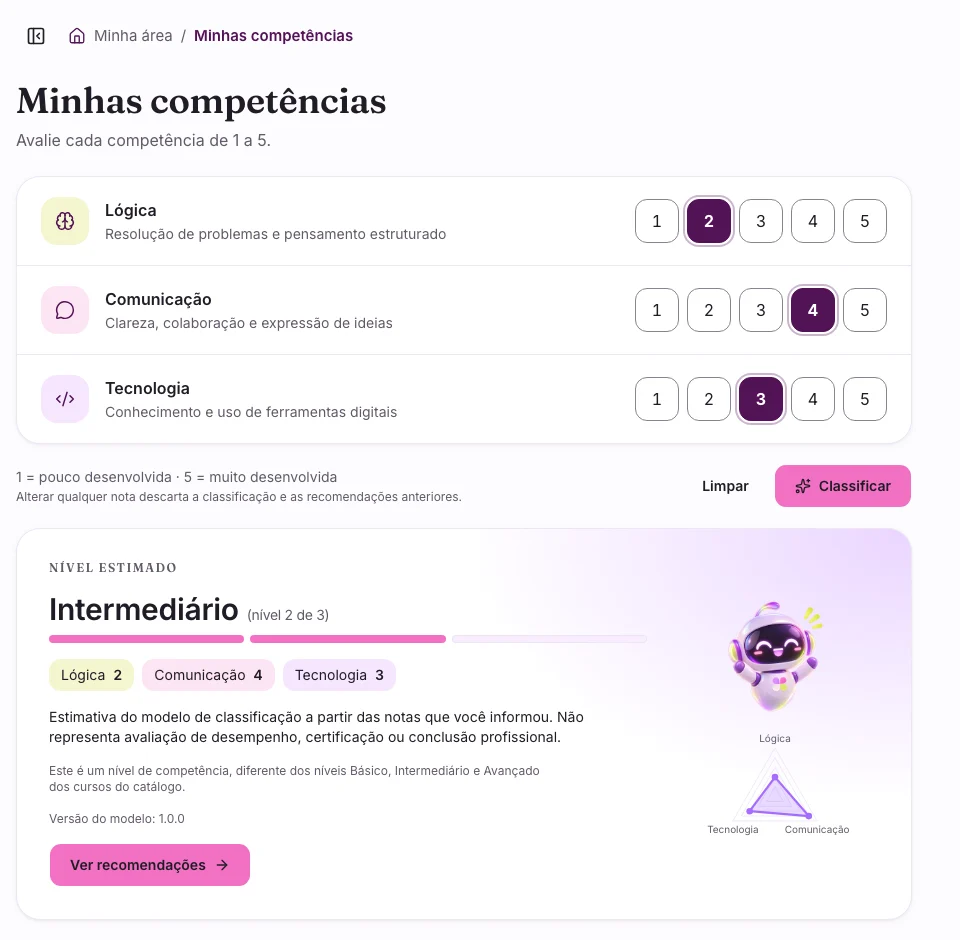
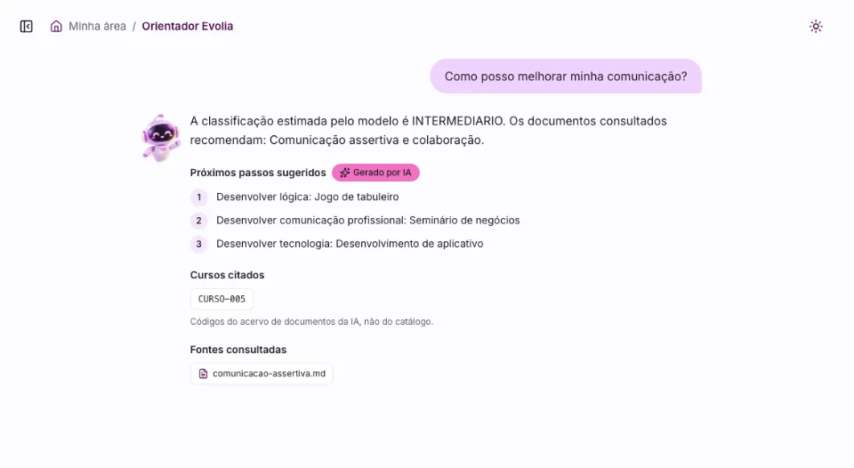
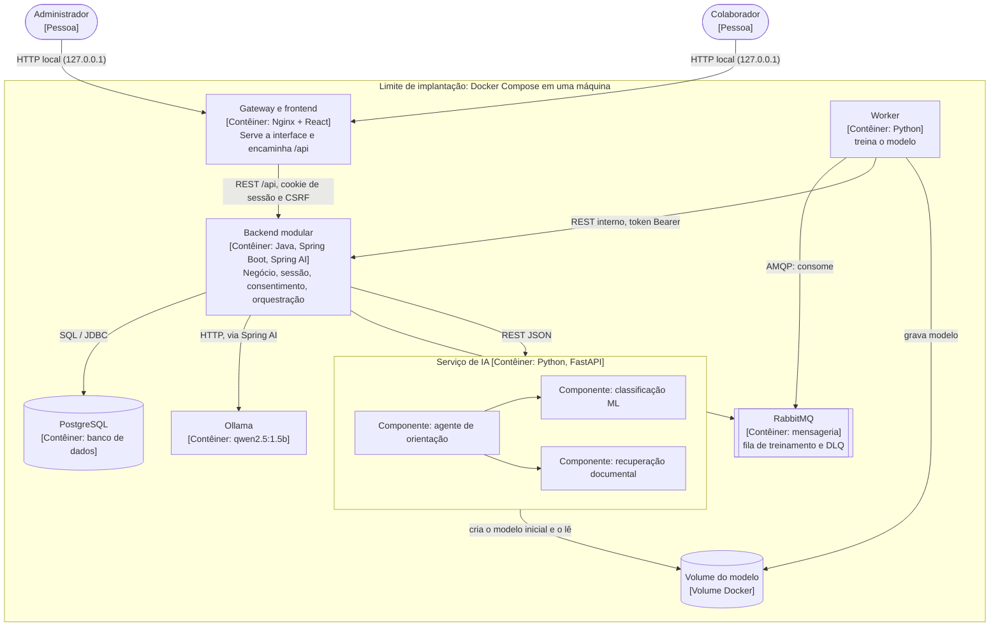
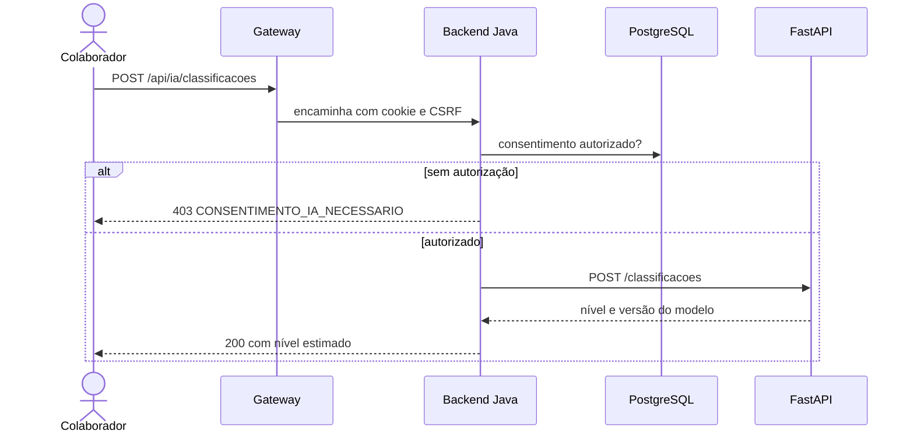
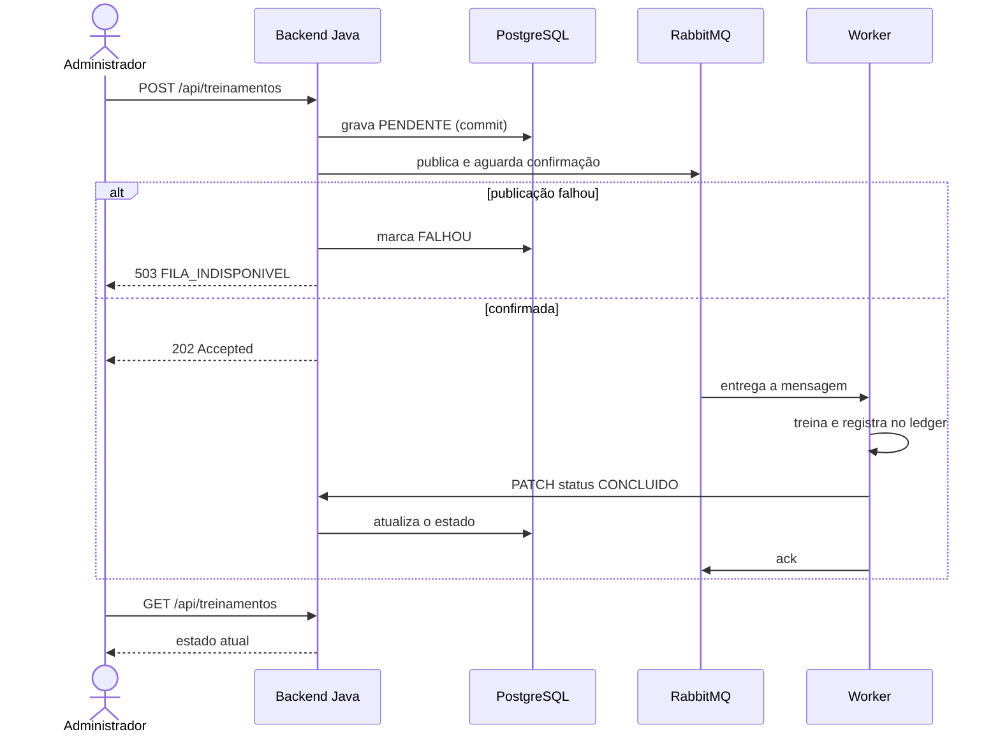

<p align="center">
  
</p>

<h1 align="center">Evolia</h1>
<p align="center"><em>Inteligência que desenvolve pessoas.</em></p>

A Evolia é uma plataforma de educação corporativa. Nela, cadastramos colaboradores e cursos, estimamos o
nível de competência com *Machine Learning*, recomendamos cursos a partir de documentos, oferecemos
orientação com apoio de IA (somente com autorização) e treinamos o modelo de forma assíncrona.

**Para executar agora:** siga as [instruções de execução](#como-executar).

| | |
| --- | --- |
| **Instituição** | Facens |
| **Disciplina** | DevOps e QA |
| **Avaliação** | Prova AF — Estudo de Caso 1 |
| **Entrega** | 01/12/2026 |
| **Arquitetura escolhida** | Alternativa A: monólito modular híbrido com serviços especializados de IA |

**Integrantes**

| Nome completo | Apresentação | Frente registrada nos commits |
| --- | --- | --- |
| Isadora Gesaro Rezende | Equipe, problema, requisitos e C4 | Serviço de IA: classificação, recomendações, orientação e *worker* |
| Maria Julia de Paula Dutil | Serviços, arquitetura, gateway e ADR | Backend, frontend, infraestrutura, testes integrados e documentação |
| Felipe de Brito Lima | Comunicação, ASRs, limitações e conclusão | Backend de treinamento, RabbitMQ/Compose, testes integrados, scripts, CI e documentação de infraestrutura |

Os registros acadêmicos (RA) constam na versão privada de identificação, fora deste repositório público.

> [!NOTE]
> Este é um projeto acadêmico. Ele roda localmente, com dados e documentos fictícios, e não é um produto
> pronto para produção.

## Índice

- [Como executar](#como-executar) e [problemas comuns](#problemas-comuns)

1. [Situação-problema](#1-situação-problema)
2. [Visão geral da solução](#2-visão-geral-da-solução)
3. [Requisitos funcionais](#3-requisitos-funcionais)
4. [Requisitos não funcionais](#4-requisitos-não-funcionais)
5. [Item A — Organização arquitetural no código](#5-item-a--organização-arquitetural-no-código) · 6 pontos
6. [Item B — Arquitetura em C4](#6-item-b--arquitetura-em-c4) · 1 ponto
7. [Item C — Comunicação arquitetural](#7-item-c--comunicação-arquitetural) · 2 pontos
8. [Item D — Requisitos arquiteturalmente significativos](#8-item-d--requisitos-arquiteturalmente-significativos) · 0,5 ponto
9. [Item E — Registro da decisão arquitetural](#9-item-e--registro-da-decisão-arquitetural) · 0,5 ponto
10. [Inteligência artificial](#10-inteligência-artificial)
11. [Segurança e privacidade](#11-segurança-e-privacidade)
12. [Desempenho e qualidade](#12-desempenho-e-qualidade)
13. [Tecnologias e estrutura do repositório](#13-tecnologias-e-estrutura-do-repositório)
14. [Testes automatizados](#14-testes-automatizados)
15. [Guia de demonstração](#15-guia-de-demonstração)
16. [Limitações e evolução futura](#16-limitações-e-evolução-futura)

---

## Como executar

A aplicação inteira roda em Docker. Os comandos usam um terminal **Bash** (no Windows, o Git Bash).

### Etapa 1 — Pré-requisitos

| Ferramenta | Para quê |
| --- | --- |
| Git | Baixar o repositório |
| Docker com Docker Compose (Docker Desktop, por exemplo), em execução | Rodar a aplicação |
| Bash | Gerar a configuração inicial |
| Python 3.9 ou superior | Apenas para os scripts auxiliares: catálogo e troca de senha |

Não é preciso instalar Java, Node.js, PostgreSQL, RabbitMQ nem Ollama. Na primeira execução é necessária
conexão com a internet. Como referência, reserve cerca de 8 GB de memória para o Docker e 20 GB de disco.

### Etapa 2 — Baixar o repositório *(somente na primeira instalação)*

Em um terminal, na pasta onde o projeto deve ficar:

```bash
git clone https://github.com/rrezeendisa/Af_DevOps.git
cd Af_DevOps
```

**Resultado esperado:** o terminal fica na pasta `Af_DevOps`, a **raiz do projeto**. Todos os comandos
seguintes são executados nela.

### Etapa 3 — Configuração inicial *(somente na primeira instalação)*

No mesmo terminal, na raiz:

```bash
bash scripts/gerar-env.sh
```

O script cria o arquivo `.env`, com senhas e *tokens* aleatórios. Ele usa o Docker para calcular os *hashes*
das senhas. **Resultado esperado:** a mensagem `.env criado com permissões restritas`.

- O `.env` guarda os usuários (`AFDEVOPS_ADMIN_USERNAME`, `AFDEVOPS_COLABORADOR_USERNAME`) e as senhas das
  duas contas iniciais (`E2E_ADMIN_PASSWORD`, `E2E_COLABORADOR_PASSWORD`). Para consultá-las, abra o
  arquivo em um editor de texto. Ele pode ficar oculto no explorador de arquivos.
- O `.env` não vai para o Git. Não o compartilhe nem o mostre em gravações.
- Se o `.env` já existir, o script não altera nada e informa que o arquivo foi preservado.
- Depois da primeira inicialização, **não apague o `.env`**: o banco continua usando a senha antiga.

### Etapa 4 — Iniciar a aplicação

No mesmo terminal, na raiz:

```bash
docker compose up --build
```

A primeira execução demora, porque o Docker baixa as imagens, constrói os serviços e o Ollama baixa o
modelo (cerca de 1 GB). Esse terminal passa a mostrar os *logs*; mantenha-o aberto. Para parar, use `Ctrl+C`.

Se preferir rodar em segundo plano e liberar o terminal:

```bash
docker compose up --build -d
```

**Para conferir se está pronto**, abra **outro terminal** na raiz (ou use o mesmo, se usou `-d`):

```bash
docker compose ps
curl http://localhost:8088/healthz
```

**Resultado esperado:** os serviços principais aparecem como `healthy`, o `ai-worker` como `Up`, e o
segundo comando responde `ok`. O modelo do Ollama pode terminar de baixar depois; até lá, o Orientador
funciona sem os próximos passos gerados.

### Etapa 5 — Carregar o catálogo *(somente na primeira instalação)*

Uma instalação nova começa sem cursos. Com a aplicação no ar, em outro terminal, na raiz:

```bash
python3 scripts/preencher_catalogo.py
```

O script entra como administrador, lendo o usuário e a senha no `.env`. Nenhuma credencial é exibida.
**Resultado esperado:** uma linha para cada curso e, no final,
`18 cadastrados, 0 já existiam; 18 cursos no catálogo.`

Ele pode ser executado de novo sem duplicar cursos. Se a senha do administrador não estiver no `.env`, o
script pede a senha no terminal. Se o comando `python3` não existir no Windows, use `python`.

### Etapa 6 — Acessar e conhecer os perfis

Abra no navegador: **<http://localhost:8088>** e clique em **Acessar plataforma**.

| Perfil | Como obter o acesso | O que pode fazer |
| --- | --- | --- |
| Administrador | Usuário e senha no `.env` | Colaboradores, contas, cursos e treinamentos da IA |
| Colaborador de demonstração | Usuário e senha no `.env` | Somente consultar o catálogo |
| Colaborador individual | Criado pelo administrador (etapa 7) | Catálogo, autorização da IA, competências, recomendações e Orientador |

Nenhuma conta reúne as funções de administrador e as de IA.

### Etapa 7 — Criar uma conta individual *(somente na primeira instalação)*

Os colaboradores e as contas do nosso ambiente de desenvolvimento **não vêm pelo GitHub**. É preciso criar
uma conta na própria instalação:

1. Entre com a conta **administrador**.
2. No menu, abra **Colaboradores**, clique em **Cadastrar colaborador**, preencha nome, e-mail (fictício),
   cargo e departamento e confirme.
3. No menu, abra **Contas**, escolha o colaborador, defina um nome de usuário (letras sem acento, números,
   ponto, hífen ou sublinhado) e uma senha com pelo menos 12 caracteres em **Senha inicial**. Repita-a em
   **Confirmar senha** e clique em **Criar conta**.
4. Clique no ícone **Sair**, na parte de baixo do menu.
5. Entre com o usuário e a senha que acabou de criar.
6. Abra **Privacidade e IA** e clique em **Autorizar uso da IA**.
7. Abra **Minhas competências**, marque uma nota de 1 a 5 em cada competência e clique em **Classificar**.
8. Abra **Recomendações** e clique em **Gerar recomendações**.
9. Abra **Orientador Evolia**, escreva uma pergunta e envie. A primeira resposta com próximos passos pode
   demorar mais, porque o modelo está sendo carregado.

Faça os passos 7 a 9 sem recarregar a página: a avaliação fica só na memória. Se recarregar ou sair,
classifique de novo.

Para usar duas contas ao mesmo tempo, use uma janela normal e uma janela anônima.

### Etapa 8 — Parar e iniciar novamente

Na raiz do projeto:

| Comando | O que faz |
| --- | --- |
| `docker compose stop` | Para os contêineres, sem removê-los |
| `docker compose down` | Para e remove os contêineres; os **volumes** (banco, filas e modelos) ficam |
| `docker compose up -d` | Inicia novamente (use `--build` depois de atualizar o código) |

Nas próximas vezes, basta o último comando; as etapas 2, 3, 5 e 7 não se repetem. Não use
`docker compose down -v`: ele apaga os dados.

### Trocar uma senha (opcional)

```bash
python3 scripts/definir_credenciais.py admin
python3 scripts/definir_credenciais.py demo
python3 scripts/definir_credenciais.py colaborador --usuario NOME_DA_CONTA
```

Rode esses comandos com a aplicação no ar. Em `NOME_DA_CONTA`, escreva o nome de usuário em minúsculas. No
Windows, use o PowerShell, com `python` no lugar de `python3`, para a senha não aparecer na tela.

A senha é digitada sem aparecer na tela e deve ter pelo menos 12 caracteres. O backend é recriado, e quem
estiver conectado precisa entrar de novo. Para `admin` e `demo`, a senha nova não fica no `.env` (use
`--guardar-no-env` se quiser guardá-la).

## Problemas comuns

| Problema | O que fazer |
| --- | --- |
| A página não abre ou mostra erro logo após iniciar | Os serviços ainda estão subindo. Acompanhe com `docker compose ps` |
| A porta 8088 está ocupada | Acrescente `GATEWAY_PORT=8090` ao `.env`, rode `docker compose up -d` e use a nova porta. No script do catálogo: `EVOLIA_URL=http://127.0.0.1:8090 python3 scripts/preencher_catalogo.py` |
| O catálogo está vazio | Execute a etapa 5 |
| Usuário ou senha não funcionam | Confira o usuário e a senha no `.env`. Mudar a senha direto no arquivo não funciona. Para criar uma nova, com a aplicação no ar, rode `python3 scripts/definir_credenciais.py admin` (ou `demo`) |
| "O serviço de IA está indisponível no momento" | `docker compose up -d --force-recreate ai-service`, aguarde ficar `healthy` e, se continuar, veja `docker compose logs --tail=50 ai-service` |
| O Orientador demora ou não mostra próximos passos | A primeira geração carrega o modelo. Confira `docker compose logs --tail=20 ollama-modelo`; se o download falhou, rode `docker compose up -d ollama-modelo` |
| A tela mostra uma versão antiga | `docker compose up -d --build --no-deps gateway` e recarregue a página |
| Ver o estado e os *logs* | `docker compose ps` e `docker compose logs --tail=100 backend gateway ai-worker` |

---

## 1. Situação-problema

O enunciado descreve uma empresa de educação corporativa. Os colaboradores avaliam suas competências,
recebem recomendações de cursos e acompanham a própria evolução. A proposta usa Spring Boot para o negócio,
Python para *Machine Learning*, RabbitMQ para mensageria e REST entre as aplicações, além de RAG sobre
documentos institucionais e agentes de IA. A equipe é **pequena** e quer evitar complexidade, mas espera
**crescimento de usuários** e precisa **evoluir a IA** sem afetar o restante.

| Necessidade do cenário | Resposta da Evolia |
| --- | --- |
| Avaliar competências | Três notas informadas pelo colaborador e um modelo de classificação que estima o nível |
| Recomendar cursos | Recuperação em acervo documental, com justificativa e fonte |
| Integrar IA ao negócio | IA em processo separado (Python), acessada pelo backend por portas bem definidas |
| Controlar o acesso aos dados | Sessão no servidor, papéis, consentimento explícito e redes internas |
| Equipe reduzida | Um backend modular, um Compose e um único ponto de entrada |
| Crescimento e evolução independente | IA e *worker* isolados em contêineres; treinamento desacoplado por fila |

Atendemos apenas em parte o acompanhamento da evolução, porque não guardamos histórico (ver RF04).

## 2. Visão geral da solução

### 2.1 Funcionalidades

- **Gestão de colaboradores e contas:** cadastro, consulta e criação de conta individual.
- **Catálogo:** cursos com busca e filtros, cadastrados pelo administrador. Um script ([etapa 5 da execução](#etapa-5--carregar-o-catálogo-somente-na-primeira-instalação))
  carrega os 18 cursos de demonstração em Tecnologia, Comunicação e Raciocínio lógico.
- **Avaliação de competências:** lógica, comunicação e tecnologia, de 1 a 5, sem resposta pré-marcada.
- **Classificação por ML:** nível Iniciante, Intermediário ou Avançado.
- **Recomendações documentais:** cursos do acervo da IA, com justificativa e fontes.
- **Orientador Evolia:** pergunta e resposta, cursos citados, fontes e próximos passos quando disponíveis.
- **Consentimento:** autorização e revogação explícitas do uso de IA.
- **Treinamento assíncrono:** o administrador solicita e acompanha `PENDENTE`, `CONCLUIDO` ou `FALHOU`.

### 2.2 Perfis e permissões

| Recurso | Administrador | Colaborador individual | Colaborador de demonstração |
| --- | :---: | :---: | :---: |
| Consultar catálogo | sim | sim | sim |
| Cadastrar cursos | sim | não | não |
| Cadastrar e consultar colaboradores, criar contas | sim | não | não |
| Solicitar e acompanhar treinamentos | sim | não | não |
| Consentimento, classificação, recomendações, orientação | não | sim | não |

As contas de administrador e de demonstração são definidas no `.env`. As contas individuais ficam no
PostgreSQL, ligadas a um colaborador.

### 2.3 A aplicação

Capturas da aplicação real. Dados fictícios.

<table>
  <tr>
    <td width="50%"><br><sub>Página pública</sub></td>
    <td width="50%"><br><sub>Painel administrativo (ambiente isolado de validação, com um curso de teste)</sub></td>
  </tr>
  <tr>
    <td><br><sub>Competências e nível estimado</sub></td>
    <td><br><sub>Recomendações e fontes</sub></td>
  </tr>
  <tr>
    <td colspan="2" align="center"><br><sub>Orientador, com próximos passos gerados pelo Ollama</sub></td>
  </tr>
</table>

## 3. Requisitos funcionais

| ID | Descrição no enunciado | Implementação | Evidência | Situação e limitações |
| --- | --- | --- | --- | --- |
| **RF01** | Permitir o cadastro e a consulta de colaboradores e cursos. | Módulos `colaborador` e `curso` (REST, JPA, PostgreSQL) | `ColaboradorIntegrationTests`, `CursoIntegrationTests`, fluxo pela interface | **Atendido.** Listagens sem paginação; não há edição nem exclusão. |
| **RF02** | Classificar o nível de competência do colaborador utilizando ML. | `POST /api/ia/classificacoes` → FastAPI → árvore de decisão | `IaIntegrationTests`, testes Python, fluxo pela interface | **Atendido.** Modelo treinado com base sintética; as notas são informadas na hora. |
| **RF03** | Recomendar cursos utilizando informações recuperadas de documentos institucionais por RAG. | TF-IDF e similaridade de cosseno sobre 12 documentos | `ai-service/tests/test_recommendations.py`, fluxo pela interface | **Atendido com ressalva.** A resposta é montada de forma determinística: nenhum LLM redige a partir dos trechos. |
| **RF04** | Permitir que agentes de IA coordenem atividades de orientação e acompanhamento, com autorização do usuário. | Agente de sequência fixa, consentimento verificado no Java | `IdentidadeConsentimentoIntegrationTests`, testes do agente | **Parcial.** Há orientação e autorização; **não há acompanhamento persistente** (histórico, metas, progresso). |
| **RF05** | Permitir que o usuário acompanhe o andamento das solicitações de treinamento de modelos. | Solicitação, fila, *worker* e consulta de estado | `TreinamentoIntegrationTests`, `integration-tests/test_treinamento.py` | **Atendido.** Restrito ao administrador; o modelo novo só é carregado ao reiniciar o serviço de IA. |

## 4. Requisitos não funcionais

"Histórica" é a validação da Etapa 14.1 (28/11/2026), anterior ao redesenho da interface. "Atual" é a
verificação feita sobre a versão final.

| ID | Descrição no enunciado | Como é tratado | Validação histórica | Validação atual | Situação e limitações |
| --- | --- | --- | --- | --- | --- |
| **RNF01** | Responder a 95% das consultas de classificação em até 2 segundos, sob carga de 300 usuários simultâneos. | Sessão no servidor; BCrypt apenas no login | Carga com k6: 17.826 de 17.826 no prazo | Carga **não repetida** | **Atendido nas condições testadas** (ambiente local). |
| **RNF02** | Continuar aceitando solicitações de treinamento quando o serviço de ML estiver temporariamente indisponível. | Fila durável; o *worker* em execução não chama a API de IA | Cenário de falha com o FastAPI parado | Cenário **não repetido** | **Atendido no cenário executado.** Com o RabbitMQ parado, a solicitação é recusada (503). |
| **RNF03** | Proteger os dados pessoais e controlar o acesso dos agentes às informações e ferramentas. | Papéis, consentimento, token interno, redes internas, lista fixa de ferramentas | Testes de segurança e CSP | Testes Java e integrados; CSP sem violações nos fluxos | **Atendido no recorte local.** Sem HTTPS próprio; não certifica conformidade. |
| **RNF04** | Permitir a evolução independente dos componentes de IA, sem comprometer as funcionalidades de cadastro e consulta. | IA em contêineres próprios, atrás de interfaces | FastAPI parado: cadastro e consulta funcionando | Interface: catálogo disponível com a IA parada | **Atendido no cenário executado.** |
| **RNF05** | Manter custos de infraestrutura e operação compatíveis com uma equipe técnica reduzida. | Um Compose, um backend, modelo pequeno local | Medição de memória e disco | **Não repetida** | **Evidência favorável, só para a demonstração local.** Custo monetário e energia não medidos. |

Detalhes e dados brutos: [matriz de evidências](docs/evidencias-af.md).

## 5. Item A — Organização arquitetural no código

### 5.1 Decisão

Escolhemos o **monólito modular híbrido** (Alternativa A). As funcionalidades de negócio ficam em uma única
aplicação Spring Boot, dividida em módulos por assunto. A inteligência artificial roda em processos
separados, porque usa outra linguagem e muda em outro ritmo. O treinamento, que é demorado, passa por uma fila.

### 5.2 Comparação entre as alternativas

| Critério | Alternativa A — monólito modular híbrido | Alternativa B — microsserviços | Peso no cenário |
| --- | --- | --- | --- |
| **Modularidade** | Módulos por pacote (`colaborador`, `curso`, `treinamento`…), com fronteiras por convenção e visibilidade de pacote. | Fronteiras físicas: cada serviço com código, implantação e dados próprios. Mais forte, porém mais cara. | Os domínios ainda são pequenos; pacotes bastam. |
| **Acoplamento** | Chamadas locais entre módulos e um banco compartilhado (mais acoplado). A IA é desacoplada por contrato REST e fila. | Menor acoplamento de implantação, mas acoplamento por rede, contratos versionados e consistência eventual. | O acoplamento que importa (IA × negócio) foi tratado. |
| **Escalabilidade** | O backend escala por inteiro; os serviços de IA podem ser dimensionados à parte. Hoje as sessões em memória limitam a uma instância. | Cada serviço escala sozinho. | A meta de 300 usuários foi atingida com uma instância. |
| **Manutenção** | Um repositório, um build Java, refatorações simples, transações locais. | Mais repositórios ou pipelines, versionamento de contratos, depuração distribuída. | Três pessoas mantêm o sistema. |
| **Complexidade operacional** | Um Compose; banco, broker, três processos de aplicação, gateway e modelo local. | Descoberta de serviços, observabilidade distribuída, vários bancos e implantações. | O enunciado pede para evitá-la. |

**Por que não microsserviços em tudo.** Os microsserviços resolvem problemas que o nosso cenário ainda não
tem, como várias equipes independentes ou domínios com cargas muito diferentes. Para um grupo pequeno, o
custo de operar vários serviços e bancos apareceria logo. Separando apenas a IA, atendemos à evolução
independente pedida no enunciado sem multiplicar a operação.

### 5.3 Por que cada parte está onde está

- **Negócio no Java:** cadastro, identidade, consentimento e solicitações usam as mesmas transações e
  regras de acesso. Juntos, evitam o problema de manter dados consistentes entre serviços.
- **IA em Python:** é onde estão as bibliotecas de ML (scikit-learn). Podemos trocar o modelo ou os
  documentos sem recompilar o backend.
- **Sem dividir colaboradores e cursos:** não há motivo para escalá-los ou implantá-los separadamente.
  Dividi-los só criaria chamadas de rede e novos pontos de falha.
- **Evolução da IA:** o Java depende de duas interfaces (`ServicoIaPort` e `ProximosPassosPort`) e de um
  contrato REST. Com a IA parada, o cadastro e a consulta continuam funcionando.
- **Assincronia:** o Java publica o pedido de treinamento e responde, sem esperar o *worker*.
- **O que poderíamos separar depois, se houver necessidade real:** o módulo de treinamento, o módulo de
  identidade (com sessões compartilhadas) e o acervo de documentos.

**Trade-offs:** os módulos compartilham o banco; as fronteiras entre eles dependem da nossa disciplina; o
backend é implantado e pode falhar como uma unidade; banco e fila não participam da mesma transação.

### 5.4 Organização do código

```text
backend/src/main/java/br/edu/facens/afdevops/
├── colaborador/    cadastro e consulta de colaboradores
├── curso/          catálogo de cursos
├── identidade/     contas individuais, identidade da sessão
├── consentimento/  autorização do uso de IA
├── treinamento/    solicitações, publicação na fila e atualização de estado
├── ia/             portas e adaptadores para FastAPI e Ollama
└── seguranca/      sessão, CSRF, papéis, contexto de sessão e token interno
```

| Módulo | Principais classes | Camadas que existem |
| --- | --- | --- |
| [`colaborador`](backend/src/main/java/br/edu/facens/afdevops/colaborador) | `ColaboradorController`, `ColaboradorService`, `ColaboradorRepository` | Controller → Service → Repository (JPA) |
| [`curso`](backend/src/main/java/br/edu/facens/afdevops/curso) | `CursoController`, `CursoService`, `CursoRepository` | Controller → Service → Repository (JPA) |
| [`identidade`](backend/src/main/java/br/edu/facens/afdevops/identidade) | `IdentidadeController`, `ContasIndividuais`, `ContaRepository` | Controller → serviço → Repository |
| [`treinamento`](backend/src/main/java/br/edu/facens/afdevops/treinamento) | `TreinamentoController`, `TreinamentoService`, `PublicadorTreinamento` | Controller → Service → Repository; o controller também aciona o publicador |
| [`consentimento`](backend/src/main/java/br/edu/facens/afdevops/consentimento) | `ConsentimentoController`, `ConsentimentoService` | Controller → Service com `JdbcClient` (**sem** Repository) |
| [`ia`](backend/src/main/java/br/edu/facens/afdevops/ia) | `IaController`, `IaService`, portas e adaptadores | Controller → Service → portas (**sem** Repository) |
| [`seguranca`](backend/src/main/java/br/edu/facens/afdevops/seguranca) | `SegurancaConfig`, `FiltroContextoSessao`, `ContasDemonstracao` | Configuração e filtros |

Exemplo do fluxo em camadas ([`CursoService`](backend/src/main/java/br/edu/facens/afdevops/curso/CursoService.java)):

```java
@Transactional
public CursoResponse cadastrar(CursoRequest request) {
    var curso = new Curso(request.nome(), request.descricao(), request.cargaHoraria(),
            request.categoria(), request.nivel(), Instant.now().truncatedTo(ChronoUnit.MICROS));
    return resposta(repository.save(curso));
}
```

### 5.5 Portas e adaptadores (somente na integração com IA)

```java
// ServicoIaPort.java — o que o negócio precisa da IA
interface ServicoIaPort {
    IaDtos.Classificacao classificar(IaDtos.Competencias competencias);
    IaDtos.Recomendacoes recomendar(IaDtos.PedidoRecomendacao pedido);
    IaDtos.Orientacao orientar(long colaboradorId, IaDtos.PedidoOrientacao pedido);
}

// ProximosPassosPort.java — complemento generativo
interface ProximosPassosPort {
    List<String> gerar(IaDtos.Nivel nivel);
}
```

| Porta | Adaptador | Tecnologia | Consumidor |
| --- | --- | --- | --- |
| [`ServicoIaPort`](backend/src/main/java/br/edu/facens/afdevops/ia/ServicoIaPort.java) | [`FastApiIaAdapter`](backend/src/main/java/br/edu/facens/afdevops/ia/FastApiIaAdapter.java) | `RestClient` | [`IaService`](backend/src/main/java/br/edu/facens/afdevops/ia/IaService.java) |
| [`ProximosPassosPort`](backend/src/main/java/br/edu/facens/afdevops/ia/ProximosPassosPort.java) | [`OllamaProximosPassosAdapter`](backend/src/main/java/br/edu/facens/afdevops/ia/OllamaProximosPassosAdapter.java) | Spring AI `ChatClient` | `IaService` (opcional) |

> [!IMPORTANT]
> Portas e adaptadores existem **apenas** nessa integração. RabbitMQ e persistência são usados
> diretamente. O projeto **não** segue Arquitetura Hexagonal nem Clean Architecture como um todo.

### 5.6 Responsabilidade de cada componente

| Componente | Responsabilidade | Código |
| --- | --- | --- |
| Frontend React | Interface, navegação, validação de formulários; fala apenas com `/api` | [`frontend/src`](frontend/src) (por *feature*; HTTP em [`lib/api`](frontend/src/lib/api/cliente.ts)) |
| Gateway Nginx | Único ponto publicado: serve a interface, encaminha a API, CSP, limite de login | [`frontend/nginx`](frontend/nginx/evolia.conf) |
| Backend Spring Boot | Regras de negócio, autenticação, autorização, consentimento, orquestração | [`backend`](backend) |
| PostgreSQL | Colaboradores, cursos, contas, consentimentos e solicitações (Flyway) | [`migrations`](backend/src/main/resources/db/migration) |
| Serviço FastAPI | Classificação, recomendações e agente de orientação | [`ai-service/app`](ai-service/app) |
| Worker | Consome a fila, treina o modelo e informa o resultado | [`ai-service/worker`](ai-service/worker/consumer.py) |
| RabbitMQ | Fila de treinamento e fila de mensagens mortas | [`infra/rabbitmq`](infra/rabbitmq/definitions.json) |
| Spring AI | Cliente do modelo generativo dentro do backend | [`OllamaProximosPassosAdapter`](backend/src/main/java/br/edu/facens/afdevops/ia/OllamaProximosPassosAdapter.java) |
| Ollama | Executa localmente o modelo `qwen2.5:1.5b` | [`infra/ollama`](infra/ollama) |
| Docker Compose | Declara serviços, redes, volumes e ordem de inicialização | [`docker-compose.yml`](docker-compose.yml) |

## 6. Item B — Arquitetura em C4

Diagrama C4 de nível 2 (contêineres). Retângulos são contêineres; os três blocos dentro do serviço de IA
são **componentes** da mesma aplicação, não serviços independentes.



| Contêiner | Responsabilidade | Fala com |
| --- | --- | --- |
| Gateway e frontend | Entrega a SPA, aplica CSP e limite de login, bloqueia rotas internas | Navegador (HTTP) e backend (REST) |
| Backend modular | Autentica, autoriza, persiste, verifica consentimento, chama a IA, publica treinamentos | PostgreSQL, FastAPI, Ollama, RabbitMQ |
| PostgreSQL | Estado de negócio | Somente o backend |
| Serviço de IA | Classifica, recupera documentos e orienta | Chamado pelo backend |
| RabbitMQ | Guarda os pedidos de treinamento até serem processados | Backend publica; *worker* consome |
| Worker | Treina e devolve o estado | RabbitMQ e `PATCH /internal/...` do backend |
| Volume do modelo | Compartilha o artefato treinado | O serviço de IA grava o modelo inicial, se não existir, e o lê ao iniciar; o *worker* grava os retreinos |
| Ollama | Gera os próximos passos | Chamado pelo backend |

Somente o gateway publica porta, e apenas em `127.0.0.1`. Dois trabalhos de inicialização
(`rabbitmq-setup`, que aplica a topologia, e `ollama-modelo`, que baixa o modelo) não aparecem no
diagrama. No Compose, as redes de dados, IA, treinamento e geração são internas.

## 7. Item C — Comunicação arquitetural

**Nosso critério:** usamos REST quando alguém está esperando uma resposta rápida. Usamos RabbitMQ quando o
trabalho é demorado, pode ser feito depois e não pode se perder se o consumidor estiver parado.

### 7.1 Interações síncronas (REST)

| Interação | Por que síncrona | Contrato | Tempo limite e falhas |
| --- | --- | --- | --- |
| Navegador → gateway → backend | O usuário aguarda a tela | JSON; erros em *Problem Details* com `codigo` | Cliente: 15 s; 20 s para IA; 90 s para orientação; sem retentativa. Proxy: leitura de 110 s |
| Autenticação | Resultado imediato | `GET /api/csrf`, `POST /api/login` (204), `GET /api/me`, `POST /api/logout` | 401, 403 e 429 (limite de login) |
| Cadastro e consulta | Operações curtas em banco | `/api/colaboradores`, `/api/cursos` | 400, 404 e 409 |
| Classificação e recomendações | Resposta em milissegundos a segundos | `POST /api/ia/classificacoes` e `/recomendacoes` | Java → FastAPI: conexão 2 s, leitura 5 s; 502, 503 ou 504 |
| Orientação | O usuário espera a resposta na tela | `POST /api/ia/orientacoes` | Ollama: até 60 s; se falhar, **200 sem** `proximosPassos` |
| Java → FastAPI | Chamada de consulta, com resposta usada na hora | `/classificacoes`, `/recomendacoes`, `/orientacoes` (esta com token) | Resposta limitada a 64 KiB e validada |
| Java → Ollama | Faz parte da resposta de orientação | Spring AI (HTTP) | Sem retentativa; saída validada |
| Worker → Java | Confirmar que o estado foi gravado antes do `ack` | `PATCH /internal/treinamentos/{id}/status` com Bearer | 5 s; falha leva a nova tentativa |

### 7.2 Sequência REST: classificação de competências



### 7.3 Interação assíncrona (RabbitMQ): treinamento

1. O administrador envia `POST /api/treinamentos`.
2. O backend grava a solicitação como `PENDENTE` e confirma a transação.
3. [`PublicadorTreinamento`](backend/src/main/java/br/edu/facens/afdevops/treinamento/PublicadorTreinamento.java)
   publica uma mensagem persistente e aguarda a confirmação do broker (*publisher confirm*, 5 s). A
   resposta é `202` com `Location`.
4. O [*worker*](ai-service/worker/consumer.py) recebe com `prefetch` 1 e confirmação manual.
5. Treina o modelo, grava o artefato de forma atômica e registra o resultado em um *ledger* local.
6. Informa `CONCLUIDO` ou `FALHOU` ao backend por `PATCH` e só então dá `ack`.
7. O administrador consulta a lista ou o detalhe; a tela se atualiza enquanto houver pendentes.

| Elemento | Nome ou valor |
| --- | --- |
| Exchange (direct, durável) | `ml.training` |
| Fila | `ml.training.requests` |
| Routing key | `training.requested` |
| Fila de mensagens mortas | `ml.training.requests.dead-letter` (TTL de 7 dias, máximo de 10.000) |
| Tentativas | 1 inicial + `MAX_MESSAGE_RETRIES` (3), republicando com o cabeçalho `x-ai-retry-count`, sem atraso |
| Estados | `PENDENTE` → `CONCLUIDO` ou `FALHOU`; repetir o mesmo estado final é aceito, trocá-lo gera 409 |



**Tratamento de falhas**

- **Serviço de IA fora:** o pedido é aceito, e um *worker* já em execução o processa sem chamar a API. Em
  uma partida a frio, o Compose só inicia o *worker* com o FastAPI saudável; até lá, a mensagem aguarda.
- **Worker fora:** a mensagem fica na fila até ele voltar.
- **RabbitMQ fora:** a solicitação é registrada como `FALHOU` e a API responde 503. Não há reenvio automático.
- **Mensagem inválida:** vai para a fila de mensagens mortas.
- **Tentativas esgotadas:** o *worker* tenta marcar `FALHOU` e envia à DLQ.
- **Idempotência:** o *ledger* evita treinar de novo uma solicitação já concluída.

**Limitações reais**

- Não há *outbox*: se o processo cair entre o `commit` e a publicação, a solicitação fica `PENDENTE`.
- Se a confirmação expirar mas a mensagem tiver chegado, o registro fica `FALHOU` e o `PATCH` posterior
  recebe 409.
- Se o modelo foi treinado mas o aviso ao backend esgotou as tentativas, a mensagem vai à DLQ e o estado
  permanece `PENDENTE`.
- Não há `mandatory`/*publisher returns*: uma mensagem não roteável não seria percebida.

## 8. Item D — Requisitos arquiteturalmente significativos

Estes três requisitos do enunciado mudaram decisões do projeto.

### ASR 1 — RNF01: 95% das classificações em até 2 s com 300 usuários

- **Por que influencia:** exige que o caminho da classificação, inclusive a autenticação, seja barato.
- **Decisão:** sessão no servidor em vez de reenviar a senha a cada requisição; chamada síncrona direta
  ao serviço de IA; modelo leve carregado na inicialização.
- **Componentes:** segurança do backend, frontend, FastAPI.
- **Evidência:** antes, não atendido (a 50 usuários, 15,88% no prazo); depois, 100% no prazo com 300.
- **Consequências:** sessões em memória (uma instância; reiniciar encerra sessões); medição local.

### ASR 2 — RNF02: aceitar treinamentos com o ML indisponível

- **Por que influencia:** proíbe que o pedido dependa de o componente de ML responder.
- **Decisão:** fila durável entre backend e *worker*, com confirmação de publicação, `ack` manual e DLQ.
- **Componentes:** módulo `treinamento`, RabbitMQ, *worker*.
- **Evidência:** com o FastAPI parado, pedido aceito (202) e depois `CONCLUIDO`.
- **Consequências:** mais um componente para operar; consistência eventual; banco e fila não atômicos.

### ASR 3 — RNF03: proteger dados pessoais e controlar o acesso dos agentes

- **Por que influencia:** determina onde o acesso é decidido e o que a IA pode ver e fazer.
- **Decisão:** o backend é o único que lê o banco e verifica consentimento antes de cada operação; o agente
  tem lista fixa de três ferramentas de leitura; o modelo generativo recebe apenas o nível; token interno e
  redes internas.
- **Componentes:** gateway, backend, serviço de IA, Compose.
- **Evidência:** testes de segurança, de consentimento e bloqueios por perfil.
- **Consequências:** menos contexto para a IA (próximos passos genéricos); sem HTTPS próprio no ambiente local.

## 9. Item E — Registro da decisão arquitetural

### ADR 1 — Adotar um monólito modular híbrido

| Campo | Conteúdo |
| --- | --- |
| **Status** | Aceito |
| **Contexto** | Equipe reduzida, desejo de evitar complexidade operacional, crescimento previsto e necessidade de evoluir a IA sem afetar cadastro e consulta. |
| **Alternativas** | (A) monólito modular híbrido; (B) microsserviços. |
| **Decisão** | Alternativa A: um backend Spring Boot modular; IA e *worker* em processos separados; treinamento por RabbitMQ; um gateway como única entrada. |
| **Justificativa** | Atende à evolução independente da IA e ao requisito de disponibilidade do treinamento com o menor custo de operação. |
| **Consequências positivas** | Implantação em um comando, transações locais, depuração simples, IA substituível atrás de interfaces. |
| **Consequências negativas** | Backend como unidade única de implantação e falha; banco compartilhado; sessões em memória limitam a escala horizontal. |
| **Trade-off** | Troca-se independência total entre domínios de negócio por simplicidade, mantendo separado apenas o que tem motivo para ser. |

Texto completo: [ADR — monólito modular híbrido](docs/arquitetura-af.md#e-adr--monólito-modular-híbrido).

### ADR 2 (complementar) — Sessões no servidor no lugar de HTTP Basic

| Campo | Conteúdo |
| --- | --- |
| **Status** | Aceito (Etapa 14.1) |
| **Contexto** | Com HTTP Basic, cada requisição repetia a verificação BCrypt (custo 12). Na carga, o RNF01 não foi atendido. |
| **Decisão** | Autenticar uma vez no login e manter a sessão no servidor, com cookie `HttpOnly` e proteção CSRF. |
| **Justificativa** | Retira o BCrypt do caminho de cada requisição. Reduzir o custo do hash ou guardar credenciais em cache foi rejeitado por enfraquecer a segurança. |
| **Consequências** | RNF01 atendido; porém passam a existir estado no servidor, necessidade de CSRF e contexto de sessão, perda das sessões ao reiniciar e uma única instância sem armazenamento compartilhado. |

Texto completo: [ADR 002](docs/arquitetura-af.md#adr-002--sessões-no-servidor-no-lugar-de-http-basic).

## 10. Inteligência artificial

### 10.1 Machine Learning (classificação)

| Item | Descrição |
| --- | --- |
| Dados | Base **sintética**: as 125 combinações de notas 1–5 ([gerador](ai-service/ml/generate_dataset.py)) |
| Atributos | `logica`, `comunicacao`, `tecnologia` |
| Rótulo | Pela soma: até 7 `INICIANTE`; até 10 `INTERMEDIARIO`; acima, `AVANCADO` |
| Modelo | `DecisionTreeClassifier` (scikit-learn), `random_state=42`, versão `1.0.0` |
| Avaliação | *Holdout* 80/20 estratificado: acurácia 0,72 e F1 macro 0,726 ([resultados](ai-service/ml/evaluation_results.json)) |
| Integração | `POST /api/ia/classificacoes` → `ServicoIaPort` → FastAPI; o artefato é carregado ao iniciar |

> [!WARNING]
> As métricas medem apenas o quanto a árvore reproduz uma regra artificial. Não indicam desempenho com
> pessoas reais, e o nível exibido é uma estimativa, não avaliação profissional.

### 10.2 Recuperação documental (RAG)

O acervo tem **12 documentos institucionais fictícios** em [`ai-service/knowledge/courses`](ai-service/knowledge/courses),
cada um com competência, nível, pré-requisitos, descrição e objetivos.

1. As competências-alvo são as citadas na pergunta; sem citação, as de nota até 3 (ou a menor).
2. Os textos são vetorizados com **TF-IDF** (palavras e pares de palavras, sem acentos).
3. A relevância é a **similaridade de cosseno**; resultados sem similaridade são descartados.
4. Filtra-se por nível e competência e devolvem-se até três cursos.
5. A justificativa é a descrição do documento mais os requisitos; as fontes são os nomes dos arquivos.

Há busca nos documentos, mas a resposta é **determinística**: nenhum modelo de linguagem escreve um texto a
partir deles.
Os identificadores `CURSO-001` a `CURSO-012` são do acervo e **não** são os IDs do catálogo no PostgreSQL.

### 10.3 Agente de orientação

- **Responsabilidade:** montar uma orientação a partir da classificação e das recomendações
  ([`GuidanceAgent`](ai-service/app/guidance_agent.py)).
- **Ferramentas:** `consultar_competencias`, `classificar_competencias`, `recomendar_cursos`, nesta ordem,
  no máximo três chamadas; todas de leitura.
- **Restrições:** não usa LLM, não escolhe ferramentas dinamicamente e não consulta o banco.
- **Consentimento e isolamento:** verificados pelo backend antes da chamada; o colaborador vem da sessão,
  nunca do corpo da requisição.
- **Não há** memória de conversa nem acompanhamento persistente: cada pergunta é independente.

### 10.4 Spring AI e Ollama (complemento generativo)

| Item | Descrição |
| --- | --- |
| Papel do Spring AI | `ChatClient` que isola o modelo atrás de `ProximosPassosPort` |
| Modelo | `qwen2.5:1.5b` no Ollama local (temperatura 0,2, até 128 *tokens*) |
| O que é enviado | Instruções fixas e **apenas o nível** de competência. Nem pergunta, nem notas, nem identidade |
| Validação | JSON apenas com `proximosPassos`, de 1 a 3 frases distintas de até 120 caracteres |
| Fallback | Falha, tempo esgotado (60 s) ou saída inválida: a orientação base segue sem os passos |
| Limitação | Os passos são **genéricos**, porque o modelo só conhece o nível |

O Ollama **não** classifica competências nem recupera documentos. Na interface, o que veio do modelo é
marcado como "Gerado por IA".

## 11. Segurança e privacidade

| Mecanismo | Como funciona |
| --- | --- |
| Sessão | Em memória no backend, 30 minutos de inatividade; o identificador é trocado no login |
| Cookies | `EVOLIA_SESSAO` e CSRF `HttpOnly` e `SameSite=Strict` |
| Spring Security | Rotas liberadas uma a uma; o restante é negado ([`SegurancaConfig`](backend/src/main/java/br/edu/facens/afdevops/seguranca/SegurancaConfig.java)) |
| Senhas | BCrypt custo 12; mínimo de 12 caracteres nas contas individuais |
| CSRF | Token obtido em `GET /api/csrf` e enviado em `X-XSRF-TOKEN` em cada escrita |
| Contexto de sessão | `X-Evolia-Contexto` impede que uma aba use a sessão de outra pessoa |
| Perfis | Administração, catálogo e IA separados; a IA exige conta individual |
| Consentimento e revogação | Nunca pré-marcado; verificado a cada operação; revogar descarta os resultados na tela |
| Isolamento no navegador | Resultados só em memória; troca de sessão cancela requisições e limpa o cache |
| Autenticação interna | `INTERNAL_API_TOKEN` entre Java e `/orientacoes` e entre *worker* e backend |
| CSP e cabeçalhos | `default-src 'none'`, sem enquadramento, `nosniff` ([gateway](frontend/nginx/evolia-headers.inc)) |
| Limite de requisições | Login: 10 por segundo por IP, rajada de 50 (resposta 429) |
| Exposição | Só o gateway publica porta; redes internas para banco, IA e fila |

**Para publicar a aplicação na internet**, precisaríamos pelo menos de: HTTPS com HSTS e
`SESSION_COOKIE_SECURE=true`; armazenamento compartilhado de sessões; bloqueio de tentativas por conta e
limites nas demais rotas; troca e recuperação de senha e segundo fator; autenticação também nas rotas de
classificação e recomendação do serviço de IA (hoje protegidas só pelo isolamento de rede); gestão de
segredos, registro de auditoria, histórico de consentimento e avaliação de adequação à LGPD.

## 12. Desempenho e qualidade

### 12.1 A otimização da autenticação (medições históricas)

**Cenário inicial (Etapa 14, 27/11/2026).** Autenticação HTTP Basic sem estado: cada interação fazia
duas requisições autenticadas (CSRF e classificação), cada uma com verificação BCrypt.

**Problema.** O RNF01 não foi atendido: com 50 usuários, só 15,88% no prazo.

**Hipótese.** O custo do BCrypt a cada requisição saturava o processador. Ela foi sustentada por indícios
(Java perto de 7,8 de 8 núcleos, serviço de IA quase ocioso, vazão estagnada, leitura do código); **não
houve *profiling*** por etapa.

**Decisão.** Sessões no servidor (ADR 002). Depois da mudança, um teste confirma que o BCrypt roda no login
e não nas operações autenticadas (`SessaoIntegrationTests`).

**Metodologia.** k6 pelo gateway; patamares de 10, 50, 100, 200 e 300 usuários; 30 s de subida, 30 s de
aquecimento e janela de 120 s; 300 contas fictícias com consentimento, criadas fora da medição. Interação válida:
HTTP 200 com nível e versão do modelo, em até 2.000 ms.

**Ambiente.** Mac Intel i5, 16 GB; Docker com 8 vCPUs e 7,75 GiB; k6 na mesma máquina; uma instância por
serviço; HTTP em *loopback*; Ollama desligado; navegador e IDEs abertos.

| Usuários | Antes: p95 | Antes: no prazo | Depois: p95 da classificação | Depois: no prazo |
| ---: | ---: | ---: | ---: | ---: |
| 10 | 453 ms | 100% | 18 ms | 100% |
| 50 | 4.339 ms | 15,88% | 16 ms | 100% |
| 100 | 8.156 ms | 0,25% | 16 ms | 100% |
| 200 | 16.505 ms | 0,14% | 21 ms | 100% |
| **300** | inconclusivo | — | **33 ms** | **100%** |

No cenário final com 300 usuários simultâneos: **17.826 de 17.826** classificações válidas, **100%** dentro
do limite, **p95 de 33 ms** na classificação e **p95 de 42 ms** na interação completa, sem falhas.

| Momento | Revisão |
| --- | --- |
| Antes | `23ea620`, com alterações locais não registradas; código na tag `checkpoint-etapa14` (`13264b4`) |
| Depois | `676ad62`, árvore limpa (tag `checkpoint-etapa14-1` no *merge* posterior) |

> [!IMPORTANT]
> São medições **históricas e locais**: uma rodada por patamar, sem ensaio prolongado nem busca da
> capacidade máxima. **Não foram repetidas na versão visual final.** Backend e Compose não mudaram desde
> `676ad62`; o acervo do RAG cresceu, mas não participa da classificação.

Dados: [Etapa 14.1](docs/evidencias-etapa14-1/README.md) e [Etapa 14](docs/evidencias-etapa14/README.md).

### 12.2 Suítes na versão atual (28/11/2026)

Resultados obtidos antes de incluirmos as capas dos cursos. Depois disso, repetimos apenas os testes de
catálogo e de imagens (59 de 59), além de typecheck, lint e build.

| Suíte | Resultado |
| --- | ---: |
| Java (unitários e Testcontainers) | 274 de 274 |
| Python (`ai-service`) | 40 de 40 |
| Frontend (Vitest), com typecheck, lint e build | 574 de 574 |
| Integração pelo gateway, em projeto isolado | 55 de 55 |

A suíte do frontend já apresentou falhas intermitentes com a máquina carregada
([pendências](frontend/PENDENCIAS.md)).

### 12.3 Integração contínua

A [pipeline](.github/workflows/ci.yml) roda em *pull requests* e na `main`: Java, Python, frontend,
validação do Compose e das imagens e, por fim, os testes integrados. **Estado real:** as execuções no
GitHub em 27/11/2026 foram sobre revisões anteriores e a última falhou na `main` (teste do consumidor da
fila, depois corrigido). **Ela ainda não rodou sobre a versão atual.** Carga, cenários de falha, testes de
navegador e Ollama não fazem parte da CI.

## 13. Tecnologias e estrutura do repositório

| Área | Tecnologias | Por que |
| --- | --- | --- |
| Frontend | React 19, TypeScript, Vite, Tailwind CSS, shadcn/ui, TanStack Query, React Hook Form, Zod | Tipagem estrita, cache de consultas e validação dos contratos no navegador |
| Backend | Java 17, Spring Boot, Spring Data JPA, Spring AI, Flyway | Proposta do enunciado; maturidade para negócio e segurança; esquema versionado |
| Inteligência artificial | Python 3.13, FastAPI, scikit-learn, Ollama | Ecossistema de ML e modelo local sem custo por chamada |
| Persistência | PostgreSQL 17 | Dados relacionais com restrições de unicidade e integridade |
| Mensageria | RabbitMQ 4 | Fila durável, confirmações e DLQ, adequada ao volume do cenário |
| Infraestrutura | Docker Compose, Nginx | Ambiente reproduzível em uma máquina e um único ponto de entrada |
| Segurança | Spring Security, BCrypt, CSP | Controle de acesso no servidor e defesa no navegador |
| Qualidade | JUnit, Testcontainers, pytest, Vitest, Testing Library, httpx, k6 | Testes em cada camada, com banco e broker reais nos de integração |
| Integração contínua | GitHub Actions | Verificação automática antes do *merge* |

```text
.
├── backend/              aplicação Spring Boot (módulos por domínio) e migrations
├── frontend/             SPA React, configuração do Nginx e design system
├── ai-service/           ML, recuperação documental, agente e worker
├── infra/                topologia do RabbitMQ e modelo do Ollama
├── integration-tests/    testes ponta a ponta e roteiros de carga
├── scripts/              .env, credenciais, catálogo e testes integrados
├── docs/                 arquitetura, evidências, roteiro e imagens
├── .github/workflows/    pipeline de CI
└── docker-compose.yml    ambiente integrado (há variações de diagnóstico e Ollama nativo)
```

Documentos: [arquitetura](docs/arquitetura-af.md) · [backend](backend/README.md) ·
[serviço de IA](ai-service/README.md) · [infraestrutura](infra/README.md) ·
[contratos da API](frontend/API_CONTRACTS.md) · [design system](frontend/DESIGN_SYSTEM.md) ·
[créditos das imagens](frontend/src/assets/CREDITOS.md).

## 14. Testes automatizados

A instalação está em [Como executar](#como-executar). Para rodar os testes são necessárias outras
ferramentas, que não são usadas na execução normal. Os comandos partem da raiz.

```bash
# frontend (Node 24)
(cd frontend && npm ci && npm run typecheck && npm run lint && npm test && npm run build)
# backend (JDK 17 ou 21, com o Docker em execução)
(cd backend && ./mvnw -B verify)
# serviço de IA (Python 3.13)
(cd ai-service && python -m pip install -r requirements.txt && python -m pytest)
# ponta a ponta (Python 3.12 ou superior); --down encerra os contêineres e preserva os volumes
COMPOSE_PROJECT_NAME=evolia-testes ./scripts/testes-integrados.sh --down
```

Os testes ponta a ponta gravam cursos e treinamentos. O nome de projeto próprio cria volumes separados dos
da demonstração. Antes, pare a aplicação principal (`docker compose stop`), porque as portas são as mesmas.

Diagnóstico, Ollama nativo e carga: [infraestrutura](infra/README.md) e
[roteiros de carga](integration-tests/carga/README.md).

## 15. Guia de demonstração

Seguimos a ordem pedida pela professora, com cerca de 6 minutos para cada integrante. As falas e a
preparação do ambiente estão no [roteiro](docs/roteiro-apresentacao.md).

| Parte | Quem | Tempo | O que explicar | O que mostrar | Requisito ou item |
| :---: | --- | ---: | --- | --- | --- |
| A | Isadora | 0,5 min | Equipe, nomes completos, RAs, projeto e data | Identificação (versão privada, com RAs) | — |
| B | Isadora | 2,5 min | Problema e requisitos | Seções [1](#1-situação-problema), [3](#3-requisitos-funcionais) e [4](#4-requisitos-não-funcionais) | RF01–RF05, RNF01–RNF05 |
| C | Isadora | 3 min | Arquitetura C4 | Seção [6](#6-item-b--arquitetura-em-c4), direto no README | Item B |
| D | Maria Julia | 2,5 min | Serviços e módulos implementados | Seções [5.4](#54-organização-do-código) e [5.6](#56-responsabilidade-de-cada-componente); aplicação em execução | Item A, RF01–RF05 |
| E | Maria Julia | 2,5 min | Microsserviços, monólito modular híbrido, gateway e ADR | Seções [5.2](#52-comparação-entre-as-alternativas) e [9](#9-item-e--registro-da-decisão-arquitetural); [`evolia.conf`](frontend/nginx/evolia.conf) | Itens A e E |
| F | Maria Julia | 1 min | Arquitetura Hexagonal e Ports and Adapters (aplicação parcial) | Seção [5.5](#55-portas-e-adaptadores-somente-na-integração-com-ia); [`ServicoIaPort`](backend/src/main/java/br/edu/facens/afdevops/ia/ServicoIaPort.java) | Item A |
| G | Felipe | 4 min | REST, RabbitMQ e os três ASRs | Seções [7](#7-item-c--comunicação-arquitetural) e [8](#8-item-d--requisitos-arquiteturalmente-significativos); [`PublicadorTreinamento`](backend/src/main/java/br/edu/facens/afdevops/treinamento/PublicadorTreinamento.java) | Itens C e D |
| H | Felipe | 1,5 min | Limitações | Seção [16](#16-limitações-e-evolução-futura) | RF03, RF04 |
| I | Felipe | 0,5 min | Considerações finais | Seção [2](#2-visão-geral-da-solução) | — |

## 16. Limitações e evolução futura

**Limitações da versão entregue**

- **RF03:** há recuperação documental, sem geração de texto por LLM fundamentada nos documentos.
- **RF04:** parcial; não há acompanhamento persistente da aprendizagem.
- Modelo treinado com **dados sintéticos**; documentos institucionais **fictícios**.
- Acervo da IA sem ligação com o catálogo; alguns títulos aparecem com níveis diferentes nos dois.
- Próximos passos generativos **genéricos**, baseados só no nível.
- **Sessões em memória:** uma instância do backend; escalar exigiria armazenamento compartilhado.
- Sem autocadastro público, edição ou exclusão de registros, paginação, troca de senha pela interface,
  matrículas, progresso ou certificados.
- Um modelo novo só vale depois de reiniciar o serviço de IA.
- Ambiente local: sem HTTPS próprio, alta disponibilidade, observabilidade, backup automatizado ou testes
  de carga na versão final. Imagens da interface geradas por IA.

**Possíveis evoluções** (não implementadas)

- Histórico de avaliações, metas e progresso, completando o RF04.
- Geração fundamentada nos trechos recuperados e ligação entre acervo e catálogo.
- Padrão *outbox* e reenvio com atraso na mensageria; recarga do modelo sem reinício.
- Sessões compartilhadas, HTTPS, observabilidade e novas medições de carga.
